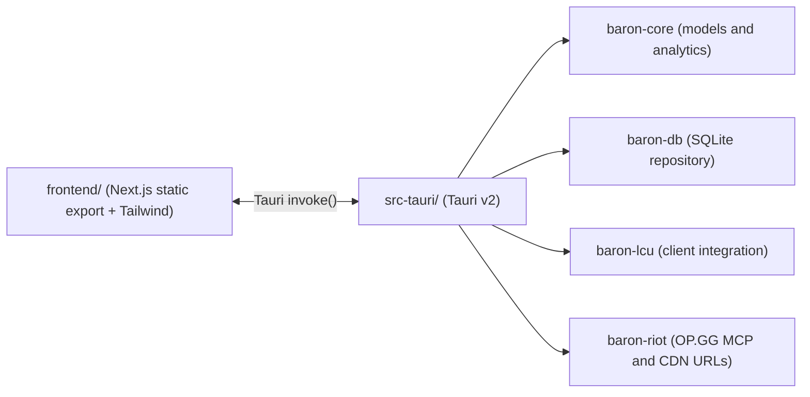

<div align="center">


# Baron

**A 100% Free, Ad-Free, Local-First League of Legends Desktop Companion & Deep Analytics Platform**

[-24C8D8?style=for-the-badge&logo=tauri&logoColor=white)](https://v2.tauri.app/)
[-000000?style=for-the-badge&logo=nextdotjs&logoColor=white)](https://nextjs.org/)
[](https://tailwindcss.com/)
[](https://www.rust-lang.org/)
[](https://bun.sh/)
[](https://www.sqlite.org/)
[](LICENSE)

</div>

---

## Why Baron?

Baron aims to bring League of Legends draft assistance, spectating, post-game timelines, meta tier lists, and collection tracking together in a free, ad-free, local-first desktop companion.

It uses a **Tauri v2** shell with the OS native WebView (Edge WebView2 on Windows, WKWebView on macOS), a TypeScript **Next.js 16** static-export frontend, and a Rust backend—without a bundled Chromium or Node.js runtime.

## Current status

Baron is an early development release. Many views still contain sample data and should not be treated as live account or match data.

- **Tier list:** The desktop app requests current lane rankings from the official [OP.GG MCP server](https://github.com/opgginc/opgg-mcp), with attribution. The feed does not expose patch, rank, region, or period filters. The live top-lane backend request was verified in hosted CI; the complete desktop UI has not yet been verified end to end.
- **Other providers:** U.GG, DPM.LOL, LoLalytics, MetaSRC, and Meraki are disabled until verified integrations are available. Automatic failover and provider build data are not implemented.
- **Champ Select, Post-game, Spectate, Leaderboards, and Collections:** The interfaces and supporting models are under development and may show sample data. Rune-page payload construction does not imply automatic client injection is working.
- **Appearance:** Cool-Black Dark, Cool-Slate Light, and System Default themes, plus a global `Ctrl+K` command palette.

## Tech Stack

| Layer | Technology | Role in Baron |
| :--- | :--- | :--- |
| **Desktop Host & IPC** | [Tauri v2](https://v2.tauri.app/) (`baron-app` in `src-tauri/`) | Native OS WebView, static bundle embedding (`custom-protocol`), Tauri IPC |
| **Frontend Framework** | Next.js `16.4.6` (`output: 'export'`, React 19, TypeScript) | Static UI compiled to `frontend/out/` |
| **Styling & Components** | Tailwind CSS `4.3.5`, `@shadcn`, `@react-bits`, `@aceternity`, `@magicui` | Shared theme tokens and components |
| **Package & Lint Tooling** | Bun + VoidZero Oxlint | Dependency management and frontend linting |
| **Local Client & Game API** | Local `lockfile` and Live Client data support | League client integration (`baron-lcu`) |
| **Riot & Meta Data** | Data Dragon, CommunityDragon, OP.GG MCP | Assets and tier-list data (`baron-riot`) |
| **Local Persistence** | `rusqlite` (`bundled`) | SQLite schema and repository (`baron-db`) |

## Architecture & Workspace Structure



```text
baron/
├── Cargo.toml                  # Rust workspace
├── components.json             # Shared UI registry config
├── AGENTS.md                   # Engineering rules & CI/CD policy
├── CLAUDE.md -> AGENTS.md      # Symlinked agent instructions
├── LICENSE                     # MIT License
├── assets/logo/                # Baron mascot and Windows icon
├── installer/baron.nsi         # NSIS Windows installer
├── frontend/                   # Next.js + Tailwind + Bun + Oxlint
├── src-tauri/                  # Tauri v2 desktop host
├── crates/
│   ├── baron-core/             # Domain models and analytics
│   ├── baron-db/               # SQLite schema and repository
│   ├── baron-lcu/              # League client support
│   └── baron-riot/             # Provider and CDN support
└── docs/
    ├── changelogs/changelogs.md
    └── spec/                   # Product & technical specifications
```

## Development & Verification

### Frontend checks

Prerequisite: [Bun](https://bun.sh/) (`1.3+`).

```bash
cd frontend
bun install --frozen-lockfile
bun test tests/provider-availability.test.js
bun run lint
bun run typecheck
bun run build
```

### Rust & Desktop Packaging

Per [`AGENTS.md`](AGENTS.md), do not run local Cargo builds or tests. Rust checks and Windows/macOS packaging run on GitHub-hosted runners:

- [CI Workflow](.github/workflows/ci.yml) — frontend and Rust checks.
- [Pre-Release Workflow](.github/workflows/pre-release.yml) — dev builds on `v*-dev*` tags or manual dispatch.
- [Release Workflow](.github/workflows/release.yml) — stable builds on semver tags or manual dispatch.

## Documentation

- [Consolidated Changelog](docs/changelogs/changelogs.md)
- [Tauri v2 + Next.js Technical Spec](docs/spec/spec.md)
- [Product Context](PRODUCT.md) and [Design System](DESIGN.md)
- [Product Requirements Document](docs/spec/prd.md)
- [Data Sources & API Specification](docs/spec/api-data-sources.md)
- [UI/UX Design Specification](docs/spec/ui-ux-design.md)

## Riot Games Fair Play Notice

Baron must comply with Riot Games' [Third-Party Application Policies](https://support-leagueoflegends.riotgames.com/hc/en-us/articles/225266848-Third-Party-Applications). It must not track hidden enemy cooldowns, reveal fog-of-war timers, bypass Ranked Champ Select anonymity, or automate in-game inputs.

## License

Licensed under the [MIT License](LICENSE).
