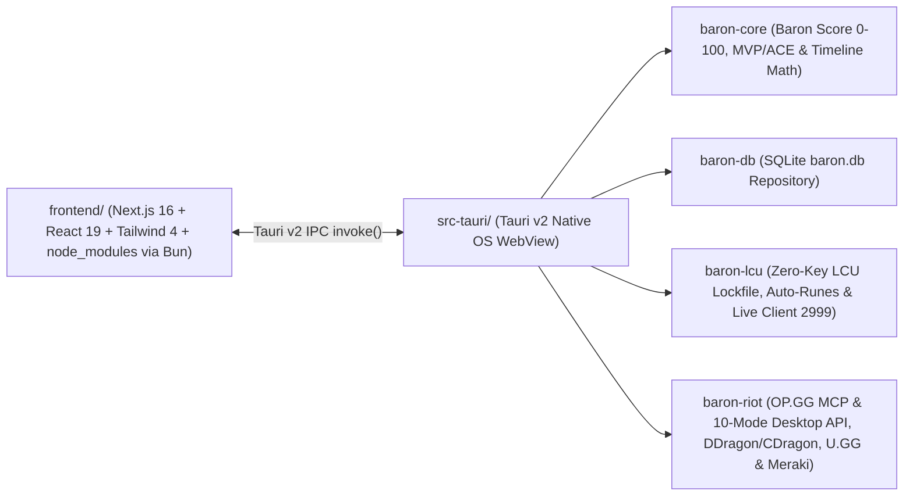

<div align="center">


# Baron

**A 100% Free, Ad-Free, Local-First League of Legends Desktop Companion & Deep Analytics Platform**

[-24C8D8?style=for-the-badge&logo=tauri&logoColor=white)](https://v2.tauri.app/)
[-000000?style=for-the-badge&logo=nextdotjs&logoColor=white)](https://nextjs.org/)
[](https://tailwindcss.com/)
[](https://www.rust-lang.org/)
[](https://bun.sh/)
[](https://www.sqlite.org/)
[](LICENSE)

</div>

---

## Why Baron?

Baron brings League of Legends draft assistance, live tier lists & multi-mode builds, all-region player & champion leaderboards, summoner match history, post-game scoreboards, esports & skin collections together in a **100% free, ad-free, local-first desktop companion**.

It uses a **Tauri v2** desktop shell with the OS native system WebView (**Edge WebView2** on Windows, **WKWebView** on macOS), a TypeScript **Next.js 16** (`React 19`) frontend powered by the **Node.js / JavaScript `node_modules` ecosystem** (installed and built via **Bun** into static `frontend/out/` assets), and a **100% native Rust backend**—so there is **no bundled Chromium / Electron browser binary** bloating the app.

## Live Features & Current Capabilities (`v0.1.0-dev.15`)

- **Automated Live Patch Discovery (`16.23+`):** Automatically discovers the latest live Riot Data Dragon version (`versions.json`) and OP.GG Desktop API patch history (`/api/global/champions/ranked/versions`) at startup and on refresh—no manual codebase updates required when a new League patch drops.
- **10-Mode Live OP.GG Tier Lists & Champion Builds:**
  - Live rankings and builds across **Ranked Solo/Duo**, **Ranked Flex**, **ARAM**, **ARAM: Mayhem**, **Classic**, **Arena**, **URF**, **Brawl**, **Nexus Blitz**, and **Doom Bots** (with automatic unversioned fallback for rotating modes).
  - Full **Rune Matrix** (`CommunityDragon` perk icons + 1-click LCU rune injection as `Baron: <ChampionName>`), starter/boots/core/4th–6th item paths, skill order & masteries, champion kit tooltips (`P/Q/W/E/R`), **Live OP.GG Matchup Guide** (strategy tips, lane & solo-kill advantage, vs-opponent items/runes/spells/skills), duo synergies, and skin popularity rankings.
- **Separated All-15-Regions Leaderboards (Ranked Players & Champion Master+):**
  - Both **Dashboard** and **Leaderboards** display **15 cleanly separated regional cards** (`KR`, `EUW`, `NA`, `EUNE`, `VN`, `BR`, `SEA`, `TW`, `JP`, `TR`, `LAN`, `LAS`, `OCE`, `RU`, `ME`) with instant switching between **Ranked Player Leaderboards** (Challenger, Grandmaster & Master Solo/Duo players sorted by Tier & LP) and **Champion Master+ Specialist Leaderboards**, plus full single-server drill-down tables.
- **Live Summoner Profile, LCU Auto-Sync & 10-Player Post-Game Scoreboard:**
  - Zero-login local **League Client (`baron-lcu`)** detection or instant `Name#TAG` lookup across all 15 regions via OP.GG MCP (`lol_get_summoner_profile`, `lol_list_summoner_matches`, `lol_get_summoner_game_detail`), interactive LP history curve, champion pool, and full 10-player Post-Game scoreboard with Baron Score (`0–100`) and `MVP` / `ACE` badges.
- **Esports, Skin Sales & Multi-Provider Comparison:**
  - Live LoL Esports match results (`lol_esports_list_schedules`), Live RP Skin Sales (`lol_list_discounted_skins`) + LCU Skin Vault, and side-by-side **U.GG Build** & **Meraki Analytics Kit** comparison with transparent provider runtime diagnostics.
- **Appearance & Theme Sync:**
  - **Dark Warm** (Smoked Espresso-Charcoal & Terracotta-Copper), **Warm Light** (Travertine Linen & Warm Parchment), and **Match OS Theme** (live Windows/macOS theme detection & sync via Tauri v2), plus a global `Ctrl+K` command palette.

## Tech Stack

| Layer | Technology | Role in Baron |
| :--- | :--- | :--- |
| **Desktop Host & IPC** | [Tauri v2](https://v2.tauri.app/) (`baron-app` in `src-tauri/`) | Native OS WebView (`WebView2` / `WKWebView` — **no bundled Chromium**), static bundle embedding, Tauri IPC |
| **Frontend Framework** | Next.js `16.4.6` (`output: 'export'`, React 19, TypeScript) + Node.js `node_modules` ecosystem | UI components & views compiled to static `frontend/out/` assets |
| **Styling & Components** | Tailwind CSS `4.3.5`, `@shadcn`, `@react-bits`, `@aceternity`, `@magicui`, `lucide-react` | Dark Warm & Warm Light theme tokens, tooltips, and interactive components |
| **Package & Lint Tooling** | Bun + VoidZero Oxlint (`1.93.0+`) | Fast `node_modules` dependency management, test runner, and zero-warning linting |
| **Local Client & Game API** | `irelia` (`0.11.2+`), local `lockfile`, and Live Client Data API (`127.0.0.1:2999`) | Zero-key League Client detection, auto-runes, and live game integration (`baron-lcu`) |
| **Riot & Meta Data** | Data Dragon, CommunityDragon, OP.GG MCP & Desktop API, U.GG & Meraki CDN | Automated patch metadata, assets, 10-mode builds, and 15-region leaderboards (`baron-riot`) |
| **Local Persistence** | `rusqlite` (`0.32+`, `bundled`) | Local SQLite schema and cache repository in `baron.db` (`baron-db`) |

## Architecture & Workspace Structure



```text
baron/
├── .github/workflows/
│   ├── ci.yml                      # Frontend (Bun + Oxlint + Next.js) & Rust (fmt, clippy, test) CI
│   ├── pre-release.yml             # Automated Windows NSIS/zip & macOS universal dev pre-releases
│   └── release.yml                 # Stable semver release packaging
├── Cargo.toml                      # Rust workspace manifest
├── components.json                 # Shared @shadcn / @react-bits / @aceternity / @magicui registry config
├── AGENTS.md                       # Engineering rules, design tokens & CI/CD policy
├── CLAUDE.md -> AGENTS.md          # Symlinked agent instructions
├── DESIGN.md                       # Dark Warm & Warm Light design system specification
├── PRODUCT.md                      # Product vision & competitive positioning
├── LICENSE                         # MIT License
├── assets/logo/
│   ├── baron_logo.png              # Transparent Baron mascot logo (RGBA)
│   └── baron.ico                   # Multi-size Windows application & installer icon
├── installer/
│   └── baron.nsi                   # NSIS Windows installer (auto-detects & upgrades prior installs)
├── frontend/                       # Next.js 16.4.6 + React 19 + Tailwind CSS 4.3.5 + Node.js modules (Bun + Oxlint)
│   ├── package.json & bun.lock     # Frontend dependencies & scripts
│   ├── .oxlintrc.json              # VoidZero Oxlint zero-warning rules
│   ├── public/                     # Static favicon.ico & baron_logo.png
│   ├── src/
│   │   ├── app/                    # Next.js App Router (globals.css, layout.tsx, page.tsx)
│   │   ├── components/
│   │   │   ├── ErrorBoundary.tsx   # Inline view error recovery boundary
│   │   │   ├── icons/              # League lane, rank crest, shard & sidebar SVG icons
│   │   │   ├── shell/              # Left grouped Sidebar.tsx & TopCommandBar.tsx
│   │   │   ├── ui/                 # Theme-synced primitives (tooltip, animated-tabs, command, table, etc.)
│   │   │   └── views/              # Dashboard, TierList, ChampionBuild, RuneMatrix, ChampSelect,
│   │   │                           # PostGame, Spectate, Collection & ProviderDiagnostics views
│   │   └── lib/                    # Tauri IPC bridge (tauri.ts), Data Dragon URLs (ddragon.ts), theme sync (theme.tsx)
│   └── tests/                      # Bun unit tests (provider-availability.test.js)
├── src-tauri/                      # Tauri v2 desktop host crate (baron-app)
│   ├── tauri.conf.json             # Window, bundle, NSIS & native WebView configuration
│   ├── capabilities/default.json   # Tauri v2 ACL capabilities
│   ├── icons/                      # Bundled taskbar, window & tray icons
│   └── src/                        # Tauri commands, OS theme sync & native window lifecycle (lib.rs, main.rs)
├── crates/
│   ├── baron-core/                 # Domain models, Baron Score (0-100) + MVP/ACE engine & Match-V5 timeline math
│   ├── baron-db/                   # SQLite schema migrations & local cache repository (baron.db)
│   ├── baron-lcu/                  # LCU lockfile/REST, 1-click rune injection, Live Client (2999) & Skin Vault
│   └── baron-riot/                 # Live patch discovery, 10-mode OP.GG Desktop API (opgg_modes.rs),
│       │                           # 15-region OP.GG MCP client & TOON parser (providers/opgg/),
│       └── src/providers/          # U.GG builds (ugg.rs) & Meraki Analytics champion kits (meraki.rs)
└── docs/
    ├── changelogs/changelogs.md    # Consolidated release & pre-release changelog
    └── spec/                       # Architecture, PRD, API data sources & UI/UX specifications
```

## Development & Verification

### Frontend checks

Prerequisite: [Bun](https://bun.sh/) (`1.3+`).

```bash
cd frontend
bun install --frozen-lockfile
bun test tests/provider-availability.test.js
bun run lint
bun run typecheck
bun run build
```

### Rust & Desktop Packaging

Per [`AGENTS.md`](AGENTS.md), do not run local Cargo builds or tests. Rust checks and Windows/macOS packaging run on GitHub-hosted runners:

- [CI Workflow](.github/workflows/ci.yml) — frontend and Rust checks.
- [Pre-Release Workflow](.github/workflows/pre-release.yml) — dev builds on `v*-dev*` tags or manual dispatch.
- [Release Workflow](.github/workflows/release.yml) — stable builds on semver tags or manual dispatch.

## Documentation

- [Consolidated Changelog](docs/changelogs/changelogs.md)
- [Tauri v2 + Next.js Technical Spec](docs/spec/spec.md)
- [Product Context](PRODUCT.md) and [Design System](DESIGN.md)
- [Product Requirements Document](docs/spec/prd.md)
- [Data Sources & API Specification](docs/spec/api-data-sources.md)
- [UI/UX Design Specification](docs/spec/ui-ux-design.md)

## Riot Games Fair Play Notice

Baron must comply with Riot Games' [Third-Party Application Policies](https://support-leagueoflegends.riotgames.com/hc/en-us/articles/225266848-Third-Party-Applications). It must not track hidden enemy cooldowns, reveal fog-of-war timers, bypass Ranked Champ Select anonymity, or automate in-game inputs.

## License

Licensed under the [MIT License](LICENSE).
