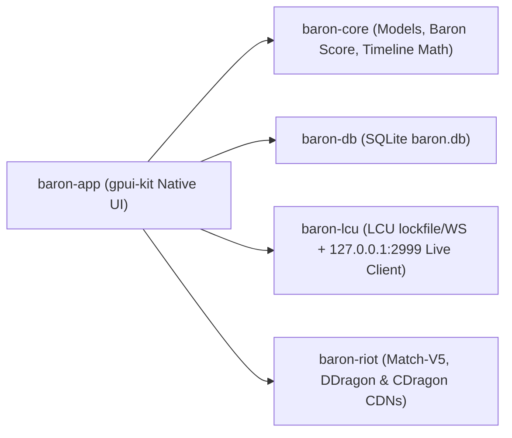

<div align="center">

# Baron

**A 100% Free, Ad-Free, Zero-Subscription Native Rust League of Legends Companion & Analytics App**

[](https://www.rust-lang.org/)
[-6366F1?style=for-the-badge&logo=zedindustries&logoColor=white)](https://github.com/longbridge/gpui-kit)
[](docs/spec/architecture-gpui.md)
[](https://www.sqlite.org/)
[](https://developer.riotgames.com/)
[](LICENSE)

</div>

---

## Why Baron?

Modern League of Legends companions (**OP.GG**, **Blitz.gg**, **U.GG**, **DPM.lol**) suffer from aggressive video-ad sidebars, Electron/Overwolf RAM bloat (**800 MB – 1.8 GB**), and recurring monthly subscriptions locking away data that comes directly from free Riot local and web APIs.

**Baron** brings together the best features of those platforms in a single, distraction-free, **100% pure Rust** GPU-accelerated desktop app (`gpui-kit`)—targeting **~30–50 MB RAM**, instant startup, **zero ads**, **zero subscriptions**, and **zero JavaScript/TypeScript**.

---

## Key Features

- **Live Draft & Champ Select Assistant (Zero Riot API Key Required)**
  - Subscribes locally to the League Client Update (**LCU**) API (`127.0.0.1`).
  - **1-Click & Auto Import:** Writes optimal Rune Pages (`Baron: <Champion>`), Summoner Spells, and In-Game Item Sets directly into your League Client.
  - **Matchup-Adjusted Builds:** Highlights rune, boot, and core item pivots based on your direct lane opponent, alongside a compact `Q > E > W` skill order strip and ally lobby scouting.
- **DPM Lens — Deep Post-Game & 1-Minute Timeline Breakdown**
  - **Baron Score (`0–100`) & `MVP` / `ACE` Badges:** Transparent performance rating combining KDA, Kill Participation, Damage/Gold efficiency, CS/m, Vision/m, and `@14m` lane diff.
  - **Lane Head-to-Head (`@14:00`):** Exact `Gold Diff @14`, `XP Diff @14`, and `CS Diff @14` vs. your direct lane opponent.
  - **Visual Timeline & Combat Radar:** Team Gold Advantage curve (`AreaChart`), 6-Axis Combat Profile (`RadarChart`), Damage/Gold Share bars (`BarChart`), and unified 5v5 scoreboard.
- **LP Progression Tracker & Session Tilt Gate**
  - Persists ranked snapshots locally in SQLite (`baron.db`) to plot historical LP trends, daily W/L net LP, win/loss streaks, and multi-account summaries.
- **Meta Tier Lists, Unlimited Custom Leaderboards & Skin Vault**
  - Virtualized, sortable Champion Tier Lists (`DataTable`).
  - Unlimited local custom leaderboards for friend squads and soloQ races.
  - **Skin Collection Value Calculator:** Reads your owned skins locally via LCU + CommunityDragon metadata to total your RP valuation and rarity breakdown.

---

## Tech Stack (100% Pure Rust — Zero Web Frameworks)

| Layer | Technology | Role in Baron |
| :--- | :--- | :--- |
|  **Language** | **Rust (2021)** | Memory-safe, single-binary native desktop performance |
|  **Native GPU UI** | [`gpui-kit`](https://crates.io/crates/gpui-kit) (`gpui` + `gpui-component` + `gpui-base` + `gpui-assets`) | Pure Rust GPU-accelerated UI (`Root`, `TitleBar`, `DockArea`, `DataTable`, `AreaChart`, `RadarChart`) with **zero JS/TS/WebView** |
|  **Local Client & Game API** | [`irelia`](https://crates.io/crates/irelia) + Local `lockfile` & `127.0.0.1:2999` | Zero-key LCU REST/WebSocket automation & real-time Live Client Data API |
|  **Riot Web API & CDNs** | [`riven`](https://crates.io/crates/riven) + Data Dragon + CommunityDragon | Rate-limited `Match-V5`, `Match-V5 Timeline`, `Account-V1`, `League-V4`, and static icons/skins |
|  **Local Database** | [`rusqlite`](https://crates.io/crates/rusqlite) (`bundled`) | Zero-config embedded persistence (`baron.db`) for matches, timelines, LP logs, and leaderboards |
|  **Async & HTTP** | `tokio` + `reqwest` + `serde` | Background async polling, asset caching, and JSON serialization |

---

## Architecture & Workspace Structure



```text
baron/
├── Cargo.toml
├── AGENTS.md                 # AI agent engineering rules
├── CLAUDE.md -> AGENTS.md    # Symlinked agent instructions
├── LICENSE                   # MIT License
├── docs/                     # Product & Architecture specifications
│   ├── README.md
│   └── spec/
│       ├── prd.md
│       ├── api-data-sources.md
│       ├── architecture-gpui.md
│       ├── ui-ux-design.md
│       └── implementation-plan.md
└── crates/
    ├── baron-core/           # Domain types, Baron Score (0-100), MVP/ACE badges, timeline metrics
    ├── baron-db/             # SQLite schema migrations & repository (baron.db)
    ├── baron-lcu/            # LCU lockfile parser, rune/item payloads, skin vault valuator
    ├── baron-riot/           # DDragon/CDragon CDN builders & Match-V5 timeline parser
    └── baron-app/            # Pure Rust gpui-kit desktop application ("Baron")
```

---

## Getting Started

### Prerequisites
- [Rust Toolchain](https://rustup.rs/) (stable `1.85+` recommended)
- Windows 10/11 (primary League Client host) or macOS

### Build & Run Tests
```bash
# Run the full workspace test suite
cargo test --workspace

# Launch the Baron native desktop app
cargo run -p baron-app
```

---

## Documentation

Detailed product specs, API research, and UI/UX wireframes live in [`docs/`](docs/README.md):
- [Product Requirements Document (PRD)](docs/spec/prd.md)
- [Free Data Sources & API Specification](docs/spec/api-data-sources.md)
- [Rust + GPUI Kit Technical Architecture](docs/spec/architecture-gpui.md)
- [UI/UX Anti-Clutter Design Specification](docs/spec/ui-ux-design.md)
- [Implementation Plan](docs/spec/implementation-plan.md)

---

## Riot Games Fair Play Notice

Baron adheres strictly to Riot Games' [Third-Party Application Policies](https://support-leagueoflegends.riotgames.com/hc/en-us/articles/225266848-Third-Party-Applications). It never tracks hidden enemy cooldowns, never reveals fog-of-war timers, never bypasses Ranked Champ Select anonymity, and never automates in-game inputs.

## License

Licensed under the [MIT License](LICENSE).
