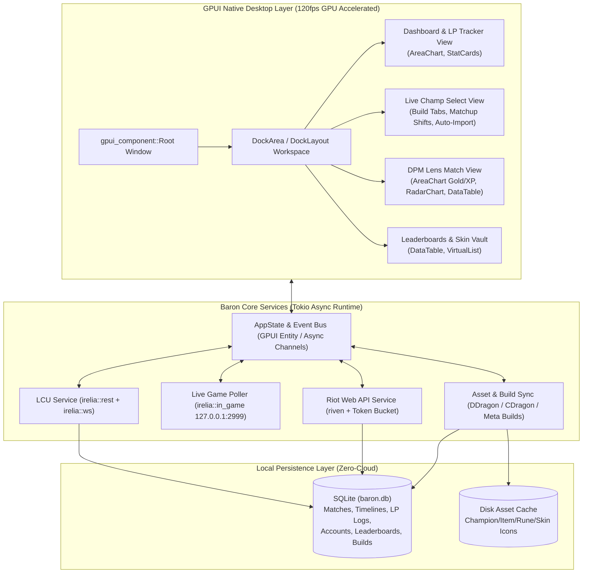

# Baron — Rust + GPUI Kit (`gpui-kit`) Technical Architecture

> Companion specification to [prd.md](file:///C:/Users/manue/desktop/projects/baron/docs/spec/prd.md) detailing the 100% pure native Rust application architecture built with **`gpui-kit`** (`gpui` + `gpui-component` + `gpui-base` + `gpui-assets` — strictly zero JavaScript, zero TypeScript, zero web frameworks/WebViews).

---

## 1. High-Level System Architecture



---

## 2. `gpui-kit` Mapping (100% Pure Rust — Zero JS/TS)

Verified via Context7 against `/longbridge/gpui-kit` and `/websites/rs_gpui-component_gpui_component`:
- **Why `gpui-kit`:** Adding `gpui-kit` in `Cargo.toml` re-exports compatible versions of `gpui` (`use gpui_kit::*;`), `gpui_kit::component` (`gpui-component`), `gpui_kit::base` (`gpui-base` behavior primitives), `gpui_kit::assets` (built-in icon assets), and `gpui_kit::platform` in one cohesive pure-Rust package (with **zero JavaScript or TypeScript** involved).

### 2.1 Application Entry, Theme & Window Initialization (`Title: "Baron"`)
`gpui_kit::init(cx)` must be called first inside `gpui_kit::application().with_assets(gpui_kit::assets::Assets).run(...)` before opening the main `"Baron"` window via `gpui_kit::open_window(...)` (which automatically wraps the root view in `Root` for dialogs, sheets, notifications, tooltips, and menus):

```rust
use gpui_kit::*;
use gpui_kit::component::{Theme, ThemeMode, TitleBar};

fn main() {
    gpui_kit::application()
        .with_assets(gpui_kit::assets::Assets)
        .run(move |cx| {
            // 1. Initialize gpui-kit (registers component styles, actions, and base primitives)
            gpui_kit::init(cx);

            // 2. Lock into Baron Obsidian Dark Mode
            Theme::change(ThemeMode::Dark, None, cx);

            // 3. Configure window options with title "Baron"
            let options = WindowOptions {
                titlebar: Some(TitleBarOptions {
                    title: Some("Baron".into()),
                    ..Default::default()
                }),
                window_min_size: Some(size(px(1180.), px(760.))),
                ..TitleBar::window_options()
            };

            // 4. Open main window (gpui_kit::open_window automatically mounts `Root`)
            gpui_kit::open_window(options, cx, |window, cx| {
                cx.new(|cx| BaronWorkspace::new(window, cx))
            })
            .expect("Failed to open Baron main window");
        });
}
```

### 2.2 UI Component Mapping by Feature (`gpui_kit::component` & `gpui_kit::base`)

| Baron UI Surface | `gpui-kit` Module / Struct | Usage Details |
| :--- | :--- | :--- |
| **Main Workspace Shell** | `gpui_kit::component::dock::{DockArea, DockLayout, panel_handle}` | `DockLayout::h_split()` and `DockLayout::tabs()` for dockable Live Draft + Match Lens panels |
| **LP Progression & Gold Diff Curves** | `gpui_kit::component::chart::{AreaChart, LineChart}` | Renders historical LP progression and 1-minute `Match-V5 Timeline` Team/Player Gold & XP diffs |
| **6-Axis Player Performance Profile** | `gpui_kit::component::chart::RadarChart` | Compares player `DPM`, `GPM`, `CS/m`, `KP%`, `Vision/m`, `DMG/Gold` against role benchmarks (`.appear(false)` when inside scrollable lists) |
| **Damage Share & Objective Bars** | `gpui_kit::component::chart::BarChart`, `Progress` | Team damage distribution, Baron/Dragon control ratios |
| **Tier Lists, Scoreboards & Leaderboards** | `gpui_kit::component::table::{DataTable, TableState, TableDelegate, Column, ColumnSort, Table}` | `DataTable` + `TableDelegate` for virtualized, sortable Champion Tier Lists & Custom Leaderboards; `Table` for 5v5 post-game scoreboards |
| **Match History Feed** | `gpui_kit::component::list` / `VirtualList` | Smooth 120fps scrolling through hundreds of cached matches with expandable `Match Lens` drawers |
| **Riot ID Command Search (`Ctrl+K`)** | `gpui_kit::component::input`, `modal`, `popover` | Instant search bar for `GameName#TAG` across regions (`NA1`, `EUW1`, `KR`, `PH2`, `SG2`, etc.) |
| **Behavior Primitives & Icons** | `gpui_kit::base::*`, `gpui_kit::assets::Assets` | Headless interactive behaviors (`gpui-base`) and built-in vector icons |

---

## 3. Tokio <-> GPUI Async Bridge

Because `gpui` manages its own UI executor on the main thread while `irelia` (hyper/rustls/tungstenite) and `riven` (reqwest/tokio) run on a `tokio` runtime:
1. Baron spawns a dedicated background multi-threaded `tokio::runtime::Runtime` on startup.
2. Background services (`LcuService`, `LiveGameService`, `RiotApiService`, `AssetService`) run on Tokio and communicate with GPUI entities via `async_channel` (or `futures::channel::mpsc`).
3. Inside GPUI views, `cx.spawn(async move |this, cx| { ... })` awaits events from the channel and calls `this.update(cx, |view, cx| { ...; cx.notify(); })` to trigger instantaneous GPU re-renders.

---

## 4. Local SQLite Schema (`baron.db`)

```sql
-- Tracked Summoner Accounts (auto-detected from LCU + manually added)
CREATE TABLE accounts (
    puuid TEXT PRIMARY KEY,
    summoner_id INTEGER,
    game_name TEXT NOT NULL,
    tag_line TEXT NOT NULL,
    platform_route TEXT NOT NULL, -- e.g. 'NA1', 'EUW1', 'KR', 'PH2'
    profile_icon_id INTEGER,
    summoner_level INTEGER,
    is_local_account BOOLEAN DEFAULT 0,
    updated_at INTEGER NOT NULL
);

-- Historical Ranked LP Snapshots (powers the LP Tracker Chart)
CREATE TABLE lp_snapshots (
    id INTEGER PRIMARY KEY AUTOINCREMENT,
    puuid TEXT NOT NULL,
    queue_type TEXT NOT NULL, -- 'RANKED_SOLO_5x5', 'RANKED_FLEX_SR'
    tier TEXT NOT NULL,       -- 'IRON' .. 'CHALLENGER'
    division TEXT NOT NULL,   -- 'I', 'II', 'III', 'IV'
    lp INTEGER NOT NULL,
    wins INTEGER NOT NULL,
    losses INTEGER NOT NULL,
    match_id TEXT,            -- optional link to the match that caused the LP change
    recorded_at INTEGER NOT NULL,
    FOREIGN KEY(puuid) REFERENCES accounts(puuid)
);

-- Immutable Match-V5 Summary Payloads
CREATE TABLE matches (
    match_id TEXT PRIMARY KEY,
    game_creation INTEGER NOT NULL,
    game_duration INTEGER NOT NULL,
    game_version TEXT NOT NULL,
    queue_id INTEGER NOT NULL,
    raw_json TEXT NOT NULL -- Zstd-compressed or raw Match-V5 JSON
);

-- Immutable Match-V5 Timeline Payloads (powers DPM Lens)
CREATE TABLE match_timelines (
    match_id TEXT PRIMARY KEY,
    raw_json TEXT NOT NULL, -- 60-second frames & coordinate events
    FOREIGN KEY(match_id) REFERENCES matches(match_id)
);

-- Indexed Participant Rows for Instant SQL Filtering & Champion Stats
CREATE TABLE match_participants (
    match_id TEXT NOT NULL,
    puuid TEXT NOT NULL,
    champion_id INTEGER NOT NULL,
    team_position TEXT NOT NULL, -- 'TOP', 'JUNGLE', 'MIDDLE', 'BOTTOM', 'UTILITY'
    win BOOLEAN NOT NULL,
    kills INTEGER NOT NULL,
    deaths INTEGER NOT NULL,
    assists INTEGER NOT NULL,
    dpm REAL NOT NULL,
    gpm REAL NOT NULL,
    cs_per_min REAL NOT NULL,
    vision_per_min REAL NOT NULL,
    gold_diff_14 INTEGER,
    xp_diff_14 INTEGER,
    cs_diff_14 INTEGER,
    baron_score REAL,
    PRIMARY KEY (match_id, puuid)
);

-- Custom Leaderboards (Unlimited Free Groups)
CREATE TABLE leaderboards (
    id INTEGER PRIMARY KEY AUTOINCREMENT,
    name TEXT NOT NULL,
    created_at INTEGER NOT NULL
);

CREATE TABLE leaderboard_members (
    leaderboard_id INTEGER NOT NULL,
    puuid TEXT NOT NULL,
    PRIMARY KEY (leaderboard_id, puuid)
);

-- Cached Patch Meta Builds & Matchup Shifts
CREATE TABLE champion_builds (
    patch TEXT NOT NULL,
    champion_id INTEGER NOT NULL,
    role TEXT NOT NULL,
    vs_champion_id INTEGER DEFAULT 0, -- 0 = general build, >0 = specific lane matchup
    build_json TEXT NOT NULL,         -- Runes, Spells, Skill Order, Item Blocks
    updated_at INTEGER NOT NULL,
    PRIMARY KEY (patch, champion_id, role, vs_champion_id)
);
```

---

## 5. Proposed Workspace Crate Layout

```text
baron/
├── Cargo.toml
├── docs/
│   ├── README.md
│   └── spec/
│       ├── prd.md
│       ├── api-data-sources.md
│       └── architecture-gpui.md
└── crates/
    ├── baron-app/          # Binary crate: GPUI window, Root, DockLayout, Views
    ├── baron-core/         # Domain models, Baron Score engine, DPM Lens timeline analyzer
    ├── baron-lcu/          # irelia LCU REST + WebSocket + LiveClient (127.0.0.1:2999) service
    ├── baron-riot/         # riven Riot Web API client + DDragon/CDragon/Meta build sync
    └── baron-db/           # rusqlite schema migrations, match/timeline cache, LP tracker queries
```
