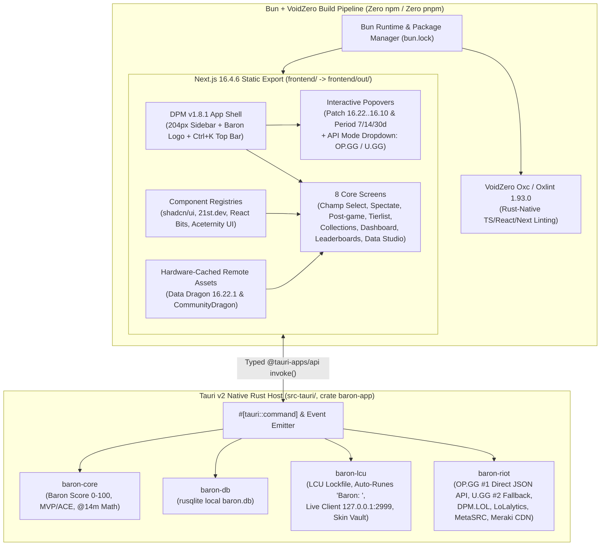

# Baron — Tauri v2 + Next.js 16 + Bun + VoidZero (`Oxc`/`Oxlint`) Technical Specification (`spec.md`)

> **Status:** Approved Target Architecture (`v0.1.0-dev.5+`)  
> **Mandate:** Combine a **100% Native Rust Backend** (`baron-core`, `baron-db`, `baron-lcu`, `baron-riot`) with **Tauri v2** and a statically exported **Next.js `16.4.6` (TypeScript + Tailwind CSS v4)** frontend powered exclusively by **Bun** and **VoidZero (`Oxc` / `Oxlint` `1.93.0`)** tooling—unlocking 100% native copy-paste support for **`shadcn/ui`**, **`21st.dev`**, **`React Bits`**, and **`Aceternity UI`** while keeping the desktop installer (`~4–6 MB`) and RAM footprint ultra-low.

---

## 1. Why This Stack Wins for `Baron`

| Layer | Technology & Version | Role in `Baron` | Why It Was Chosen |
| :--- | :--- | :--- | :--- |
| **Desktop Host & IPC** | **Tauri v2** (`tauri = "2"`, `@tauri-apps/api = "2.12.4"`) | Native window (`Title: "Baron"`), tray, system WebView, and zero-copy Rust IPC (`#[tauri::command]`) | Uses OS WebView (`WebView2` / `WKWebView`) instead of bundling Chromium—shrinking the NSIS installer to **~4–6 MB** |
| **Frontend Framework** | **Next.js `16.4.6`** (`output: 'export'`, React 19, TypeScript) | Renders all 8 **DPM APP v1.8.1** screens (`Champ Select`, `Spectate`, `Post-game`, `Tierlist`, `Collections`, `Dashboard`, `Leaderboards`, `Data Studio`) | Compiles at build time into pure static `out/` HTML/CSS/JS (**zero Node.js server at runtime**) and runs every React/TSX component natively without porting |
| **UI Component Ecosystem** | **`shadcn/ui` + `21st.dev` + `React Bits` + `Aceternity UI` + Tailwind CSS `4.3.5`** | Dark obsidian cards (`#090B10` / `#11151F`), animated score rings, popovers, command palette (`Ctrl+K`), and data tables | **100% direct CLI & copy-paste compatibility** (`bunx shadcn@latest add ...`) with zero `.tsx` translation and a unified CSS-first `@theme` token sheet |
| **Package Manager & Runner** | **Bun `1.3+`** (`bun install`, `bun run`, `bunx`, `bun.lock`) | Exclusive frontend package manager and build runner (**strictly no `npm`, no `pnpm`, no `yarn`**) | Installs dependencies 10–25× faster than `npm`/`pnpm` with a single deterministic `bun.lock` |
| **VoidZero Toolchain** | **VoidZero `Oxc` (`oxlint 1.93.0` + `oxfmt`)** | Rust-native TypeScript/React/Next.js linter and formatter | **50–100× faster than ESLint/Prettier**, written in Rust on a unified AST (`voidzero.dev`), zero slow ESLint plugin chains |
| **Native Rust Backend** | **`baron-core`, `baron-db`, `baron-lcu`, `baron-riot`** | SQLite (`baron.db`), LCU lockfile/WebSocket, `127.0.0.1:2999`, Baron Score math, and `OP.GG` (#1) / `U.GG` (#2) API pipeline | **100% unchanged pure Rust**—all database, LCU, and timeline math stays off the JS thread for minimal RAM usage |

---

## 2. System Architecture Diagram



---

## 3. Repository & Workspace Layout

```text
baron/
├── Cargo.toml                  # Rust workspace (crates/* + src-tauri)
├── assets/
│   └── logo/
│       ├── baron_logo.png      # Transparent 512x512 Baron mascot logo
│       └── baron.ico           # Multi-resolution (256..16px) Windows app & NSIS installer icon
├── installer/
│   └── baron.nsi               # NSIS installer packaging Baron.exe + baron.ico
├── frontend/                   # Next.js 16.4.6 (strict TS) + Bun + VoidZero (Oxlint) UI
│   ├── bun.lock                # Bun lockfile (NEVER package-lock.json or pnpm-lock.yaml)
│   ├── package.json            # Bun scripts + Next 16.4.6 + React 19 + @tauri-apps/api 2.12.4
│   ├── next.config.ts          # output: 'export', images: { unoptimized: true }
│   ├── .oxlintrc.json          # VoidZero Oxlint 1.93.0 configuration
│   ├── tsconfig.json           # strict: true TypeScript config
│   └── src/
│       ├── app/                # Next.js App Router (layout.tsx, page.tsx, globals.css)
│       ├── components/
│       │   ├── ui/             # shadcn/ui + 21st.dev + React Bits + Aceternity UI primitives
│       │   ├── shell/          # Sidebar, TopCommandBar, PatchPeriodPopover, ApiModeDropdown
│       │   └── views/          # ChampSelectView, SpectateView, PostGameView, TierListView, CollectionView, SecondaryViews
│       └── lib/
│           └── tauri.ts        # Typed @tauri-apps/api invoke() wrappers with browser preview fallback
├── src-tauri/                  # Tauri v2 Native Rust Host (package: baron-app, Title: "Baron")
│   ├── Cargo.toml
│   ├── build.rs
│   ├── tauri.conf.json
│   └── src/
│       ├── lib.rs              # #[tauri::command] handlers bridging baron-core/db/lcu/riot to Next.js
│       └── main.rs
└── crates/
    ├── baron-core/             # 100% Pure Rust: Domain models, Baron Score, @14m timeline math
    ├── baron-db/               # 100% Pure Rust: SQLite (baron.db) schema & repository
    ├── baron-lcu/              # 100% Pure Rust: LCU REST/WS, auto-runes, Live Client 2999, Skin Vault
    └── baron-riot/             # 100% Pure Rust: OP.GG #1 / U.GG #2 / LoLalytics / MetaSRC + DDragon 16.22
```

---

## 4. Exact Configuration Specifications

### 4.1 `frontend/package.json` (Bun + Next.js `16.4.6` + VoidZero `oxlint` `1.93.0`)
Strictly managed by **Bun** (`packageManager: "bun@1.3.0"`). `npm` and `pnpm` are forbidden:

```json
{
  "name": "baron-ui",
  "version": "0.1.0",
  "private": true,
  "packageManager": "bun@1.3.0",
  "scripts": {
    "dev": "next dev --turbopack -p 3000",
    "build": "next build",
    "lint": "oxlint --deny-warnings src",
    "typecheck": "tsc --noEmit"
  },
  "dependencies": {
    "@tauri-apps/api": "^2.12.4",
    "class-variance-authority": "^0.7.1",
    "clsx": "^2.1.1",
    "lucide-react": "^1.16.0",
    "motion": "^12.6.0",
    "next": "16.4.6",
    "react": "^19.1.0",
    "react-dom": "^19.1.0",
    "tailwind-merge": "^3.0.2"
  },
  "devDependencies": {
    "@tailwindcss/postcss": "4.3.5",
    "@types/node": "^22.13.0",
    "@types/react": "^19.1.0",
    "@types/react-dom": "^19.1.0",
    "oxlint": "^1.93.0",
    "tailwindcss": "4.3.5",
    "typescript": "^5.8.2"
  }
}
```

### 4.2 `frontend/next.config.ts` (Static Export for Tauri v2 — Zero Runtime Server)
Next.js compiles all pages and components at build time into `frontend/out/` so Tauri v2 ships pure static assets with zero Node.js server overhead:

```typescript
import type { NextConfig } from "next";

const nextConfig: NextConfig = {
  output: "export",
  distDir: "out",
  trailingSlash: true,
  images: {
    unoptimized: true,
  },
};

export default nextConfig;
```

### 4.3 `frontend/.oxlintrc.json` (VoidZero `Oxlint` Configuration)
Replaces ESLint with VoidZero's Rust-based `oxlint`:

```json
{
  "$schema": "./node_modules/oxlint/configuration_schema.json",
  "plugins": ["typescript", "react", "nextjs", "unicorn"],
  "categories": {
    "correctness": "error",
    "suspicious": "warn"
  },
  "rules": {
    "react/react-in-jsx-scope": "off",
    "nextjs/no-img-element": "off"
  }
}
```

### 4.4 `frontend/src/app/globals.css` & `frontend/postcss.config.mjs` (Tailwind CSS `4.3.5` Unified `@theme` Styling)
Tailwind CSS `4.3.5` uses the Rust-powered **Oxide engine** (`@tailwindcss/postcss`) and eliminates `tailwind.config.js` in favor of a single, unified CSS-first `@theme` token configuration in `frontend/src/app/globals.css` shared across all **DPM v1.8.1** screens, `shadcn/ui`, `21st.dev`, `React Bits`, and `Aceternity UI` components:

```javascript
// frontend/postcss.config.mjs
export default {
  plugins: {
    "@tailwindcss/postcss": {},
  },
};
```

```css
/* frontend/src/app/globals.css */
@import "tailwindcss";

@theme {
  /* Baron DPM v1.8.1 Obsidian Dark Surface Tokens */
  --color-baron-canvas: #090b10;
  --color-baron-sidebar: #0b0e14;
  --color-baron-surface: #11151f;
  --color-baron-elevated: #161b28;
  --color-baron-hover: #1c2233;

  /* Border Tokens */
  --color-baron-border-muted: #151a26;
  --color-baron-border: #1e2536;
  --color-baron-border-strong: #2e3852;

  /* Semantic & Tier Tokens */
  --color-baron-accent: #6366f1;
  --color-baron-accent-soft: #818cf8;
  --color-baron-victory: #3b82f6;
  --color-baron-defeat: #f43f5e;
  --color-baron-emerald: #10b981;
  --color-baron-gold: #f59e0b;
  --color-baron-ace: #a855f7;
  --color-baron-cyan: #38bdf8;
}

@layer base {
  body {
    background-color: var(--color-baron-canvas);
    color: #f8fafc;
    font-feature-settings: "tnum" 1, "cv02" 1;
    user-select: none;
    overflow: hidden;
  }
}
```

### 4.5 `src-tauri/tauri.conf.json`
Connects Tauri v2 directly to `bun` and `../frontend/out`:

```json
{
  "$schema": "https://schema.tauri.app/config/2",
  "productName": "Baron",
  "version": "0.1.0",
  "identifier": "com.baron.companion",
  "build": {
    "beforeDevCommand": "bun --cwd ../frontend run dev",
    "beforeBuildCommand": "bun --cwd ../frontend run build",
    "devUrl": "http://localhost:3000",
    "frontendDist": "../frontend/out"
  },
  "app": {
    "windows": [
      {
        "title": "Baron",
        "width": 1340,
        "height": 840,
        "minWidth": 1180,
        "minHeight": 760,
        "resizable": true,
        "decorations": true
      }
    ],
    "security": {
      "csp": null
    }
  },
  "bundle": {
    "active": true,
    "targets": ["nsis"],
    "icon": [
      "../../assets/logo/baron_logo.png",
      "../../assets/logo/baron.ico"
    ]
  }
}
```

---

## 5. Rust <-> Next.js Tauri v2 IPC Contract (`#[tauri::command]`)

All domain calculations, SQLite queries (`baron.db`), LCU lockfile detection, and multi-provider API requests (`OP.GG` #1 -> `U.GG` #2 -> `DPM.LOL` -> `LoLalytics` -> `MetaSRC` -> `Meraki CDN`) execute in native Rust and expose typed JSON responses to Next.js via `@tauri-apps/api/core`:

| Tauri Command (`#[tauri::command]`) | Backing Rust Crate | Purpose |
| :--- | :--- | :--- |
| `get_dashboard_state(patch, period, provider)` | `baron-core` + `baron-db` + `baron-riot` | Returns `DashboardSampleData`, active patch (`16.22`..`16.10`), period (`7d`/`14d`/`30d`), and active provider (`OP.GG`, `U.GG`, etc.) |
| `get_tier_list(patch, period, role, provider)` | `baron-riot::fallback` | Fetches/parses the champion tier list from `OP.GG` (`lol-api-champion.op.gg`) or the selected fallback provider |
| `get_champion_build(patch, champion_key, role, provider)` | `baron-riot::fallback` | Fetches runes, summoner spells, skill priority, core/completed/situational items, and pro builds |
| `apply_draft_to_lcu(champion_name, runes)` | `baron-lcu` | Injects the `Baron: <ChampionName>` rune page into the local League Client via LCU REST |
| `get_skin_collection()` | `baron-lcu::skin_vault` | Returns owned/missing skins, rarity tier counts (`Standard`..`Transcendent`), and total RP value (`223,015 RP`) |

---

## 6. GitHub-Hosted CI/CD Workflow Integration (`Bun` + `VoidZero Oxlint` + `Cargo`)

In compliance with the **Strict No-Local-Build Rule**, all frontend and backend verification runs on GitHub-hosted Actions runners:
1. **Frontend Verification (`frontend/`):**
   - `uses: oven-sh/setup-bun@v2`
   - `bun install --frozen-lockfile`
   - `bun run lint` (executes VoidZero **`oxlint --deny-warnings src`** in `<100ms`)
   - `bun run typecheck` (`tsc --noEmit`)
   - `bun run build` (generates static `frontend/out/` bundle)
2. **Backend & Desktop Packaging (`crates/` & `src-tauri/`):**
   - `cargo fmt --all -- --check`
   - `cargo clippy --workspace --all-targets -- -D warnings`
   - `cargo test --workspace`
   - `cargo build --release -p baron-app` + NSIS installer packaging (`Baron-Setup-<tag>-x86_64.exe`).
